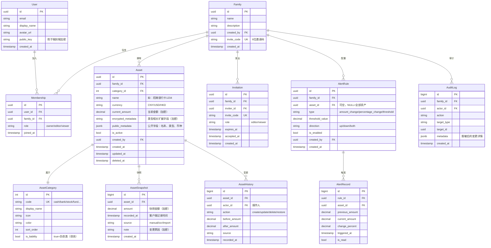

# 家庭资产管理 App — 数据模型设计

**文档版本**：v1.0
**创建日期**：2026-09-05
**关联文档**：
- `家庭资产管理App-需求定义.md` v2.1
- `鸿蒙适配方案评估.md` v1.0

---

## 一、设计原则

1. **家庭是数据隔离的最高边界** — 所有数据挂在 `family_id` 下
3. **金额一律用 `Decimal(18,4)`** — 杜绝浮点误差
4. **软删除优先** — `deleted_at` 字段，不真删
5. **客户端时间戳为权威** — `recorded_at` 由客户端记录，服务端不擅自覆盖
6. **敏感字段加密存储** — 金额、备注在客户端加密（详见 §6）

---

## 二、核心 ER 图



---

## 三、11 类资产的字段定义

### 3.1 设计策略：单表 + JSON 元数据

采用 **"单表继承"** 模式：所有 11 类资产共用 `assets` 表，差异字段存 `encrypted_metadata`（加密的 JSON）。优点：
- 查询简单（一个表就能拉出全部资产）
- 趋势图聚合无需多表 JOIN
- 新增资产类型无需改 schema

代价：
- 字段约束靠应用层保证（数据库不强制）
- 解决方案：在 TypeScript / Swift / Kotlin 中用 **discriminated union** 做强类型校验

### 3.2 各类型资产字段清单

#### ① 现金（cash）
```json
{
  "location": "钱包/抽屉/保险柜",
  "currency": "CNY"
}
```

#### ② 银行存款（bank）
```json
{
  "bank_name": "招商银行",
  "account_type": "储蓄卡/信用卡",
  "account_last4": "1234",
  "is_fixed_deposit": false,
  "maturity_date": null
}
```

#### ③ 股票（stock）
```json
{
  "symbol": "600519",
  "exchange": "SH/SZ",
  "shares": 100,
  "cost_price": 1800.50,
  "broker": "中信证券"
}
```

#### ④ 基金（fund）
```json
{
  "fund_code": "161725",
  "fund_name": "招商中证白酒",
  "shares": 5000.00,
  "cost_nav": 1.234,
  "platform": "支付宝/天天基金"
}
```

#### ⑤ 银行理财（wealth_management）
```json
{
  "product_name": "招行朝朝宝",
  "product_code": "P202401",
  "expected_rate": 0.0285,
  "principal": 50000,
  "purchase_date": "2026-01-15",
  "maturity_date": "2027-01-15"
}
```

#### ⑥ 房产（real_estate）
```json
{
  "address": "北京市朝阳区XX小区X号楼X单元X室",
  "area_sqm": 89.5,
  "purchase_price": 5800000,
  "purchase_date": "2020-03-15",
  "current_estimated_value": 5500000,
  "mortgage_remaining": 1200000,
  "property_certificate": "已上传"
}
```

#### ⑦ 车辆（vehicle）
```json
{
  "brand": "Tesla Model Y",
  "model_year": 2024,
  "purchase_price": 320000,
  "purchase_date": "2024-08-15",
  "current_estimated_value": 250000,
  "license_plate": "京A12345"
}
```

#### ⑧ 数字货币（crypto）
```json
{
  "symbol": "BTC",
  "quantity": 0.5,
  "wallet_address": "bc1q...（脱敏）",
  "exchange": "Binance/OKX/冷钱包",
  "cost_basis": 180000
}
```

#### ⑨ 贵金属（precious_metal）
```json
{
  "type": "gold/silver/platinum",
  "weight_grams": 100,
  "purity": "9999",
  "storage_location": "银行托管/家中",
  "purchase_price_per_gram": 480
}
```

#### ⑩ 债权（receivable）
```json
{
  "debtor_name": "张三",
  "principal": 50000,
  "interest_rate": 0.05,
  "loan_date": "2026-05-01",
  "due_date": "2027-05-01",
  "repayment_schedule": "一次性/分期",
  "has_agreement": true
}
```

#### ⑪ 债务（liability）⚠️ 特殊
```json
{
  "creditor": "招商银行",
  "loan_type": "mortgage/car_loan/credit_card/personal",
  "principal": 1200000,
  "interest_rate": 0.0385,
  "loan_date": "2020-03-15",
  "remaining_term_months": 240,
  "monthly_payment": 6800
}
```
> 债务是 **资产 = 负值**，标记 `AssetCategory.is_liability = true`，趋势图自动按"净资产"计算。

---

## 四、家庭与权限模型

### 4.1 核心角色

| 角色 | 创建/删除家庭 | 邀请成员 | 管理资产 | 修改成员 | 查看资产 | 查看审计日志 |
|---|---|---|---|---|---|---|
| **Owner**（创建者） | ✅ | ✅ | ✅ | ✅ | ✅ | ✅ |
| **Editor** | ❌ | ❌ | ✅ | ❌ | ✅ | ❌ |
| **Viewer** | ❌ | ❌ | ❌ | ❌ | ✅ | ❌ |

> MVP 阶段**先做这三档全局角色**。P1 阶段支持资产级 ACL（如"私房钱"）。

### 4.2 关键规则

1. **每个家庭必须有且仅有一个 Owner** — 创建者离场时需先转让
2. **Owner 不能直接退出家庭** — 必须先转让或删除家庭
3. **同一用户可加入多个家庭** — 通过 `memberships` 表多对多关联
4. **邀请码 6 位字母数字混合** — 7 天有效，最多使用 10 次

### 4.3 权限校验实现

```typescript
// 应用层统一权限函数
async function checkPermission(
  userId: string,
  familyId: string,
  action: 'asset:create' | 'asset:update' | ...
): Promise<boolean> {
  const membership = await db.memberships.findOne({
    user_id: userId, family_id: familyId
  });

  if (!membership) return false;

  const rolePermissions = {
    owner:  ['asset:create', 'asset:update', 'asset:delete', 'member:invite', ...],
    editor: ['asset:create', 'asset:update', 'asset:delete'],
    viewer: ['asset:read'],
  };

  return rolePermissions[membership.role].includes(action);
}
```

---

## 五、资产快照策略

### 5.1 为什么需要快照表

直接更新金额会丢失历史，无法做趋势图。**AssetSnapshot 表记录每一次金额变更**，是趋势图的数据源。

### 5.2 写入策略

**触发场景：**
- 用户手动更新资产金额
- OCR 识别后用户确认
- 邮件账单解析后用户确认
- API 接入自动同步（未来）

**写入逻辑：**
```typescript
async function updateAssetAmount(
  assetId: string,
  newAmount: Decimal,
  source: 'manual' | 'ocr' | 'import' | 'api',
  note?: string
) {
  await db.transaction(async (tx) => {
    // 1. 读取当前值
    const oldAsset = await tx.assets.findOne({ id: assetId });
    
    // 2. 写入快照
    await tx.asset_snapshots.create({
      asset_id: assetId,
      amount: newAmount,
      recorded_at: clientNow(), // 客户端时间
      source,
      note: encrypt(note),
    });
    
    // 3. 更新主表
    await tx.assets.update(assetId, {
      current_amount: encrypt(newAmount),
      updated_at: clientNow(),
    });
    
    // 4. 写历史
    await tx.asset_histories.create({
      asset_id: assetId,
      actor_id: currentUser.id,
      action: 'update',
      before_amount: encrypt(oldAsset.current_amount),
      after_amount: encrypt(newAmount),
      source,
    });
    
    // 5. 检查异动规则
    await checkAlertRules(assetId, oldAsset.current_amount, newAmount);
    
    // 6. 审计日志
    await tx.audit_logs.create({...});
  });
}
```

### 5.3 趋势图查询

**场景：用户看过去 6 个月总资产变化**

```sql
SELECT
  date_trunc('day', recorded_at) AS snapshot_date,
  SUM(
    CASE WHEN c.is_liability THEN -amount ELSE amount END
  ) AS net_worth
FROM asset_snapshots s
JOIN assets a ON s.asset_id = a.id
JOIN asset_categories c ON a.category_id = c.id
WHERE a.family_id = $1
  AND s.recorded_at >= $2
  AND a.deleted_at IS NULL
GROUP BY snapshot_date
ORDER BY snapshot_date;
```

**性能优化**：
- `(asset_id, recorded_at DESC)` 复合索引
- 月度聚合查询 < 50ms（10 万条快照级别）

---

## 六、加密方案

### 6.1 加密层级

| 字段 | 是否加密 | 加密方式 |
|---|---|---|
| `Asset.public_metadata.name` | ❌ | 明文（用于列表展示） |
| `Asset.public_metadata.category` | ❌ | 明文（用于筛选） |
| `Asset.current_amount` | ✅ | 客户端对称加密 |
| `Asset.encrypted_metadata` | ✅ | 整体加密 |
| `AssetSnapshot.amount` | ✅ | 客户端对称加密 |
| `AssetSnapshot.note` | ✅ | 客户端对称加密 |
| `User.email` | ❌ | 明文（登录用） |
| `User.display_name` | ❌ | 明文 |

### 6.2 密钥派生

```
用户密码
   ↓
PBKDF2 (100k iterations, SHA-256)
   ↓
User Master Key (UMK)
   ↓
HKDF 派生 → Family Data Key (FDK)
   ↓
AES-256-GCM 加密所有金额字段
```

### 6.3 家庭共享密钥

家庭成员共享同一 FDK：
1. 新成员加入时，Owner 用新成员的公钥加密 FDK
2. 新成员用自己的私钥解密 → 获得 FDK
3. 之后所有金额都用 FDK 加解密

### 6.4 加密对查询的影响

⚠️ **关键约束**：
- 服务端无法对加密字段做 SQL 聚合（金额是密文）
- 解决方案：客户端拿到全部快照后**本地聚合**
- 资产规模上限：单家庭 < 5,000 条资产 + < 100 万条快照 → 客户端聚合可行

如果未来家庭资产规模超过这个量级，需重新评估"客户端聚合 vs 同态加密 vs 服务端可信计算"。

---

## 七、索引设计

```sql
-- 用户
CREATE UNIQUE INDEX idx_users_email ON users(email);

-- 家庭成员
CREATE UNIQUE INDEX idx_memberships_user_family ON memberships(user_id, family_id);
CREATE INDEX idx_memberships_family ON memberships(family_id);

-- 资产
CREATE INDEX idx_assets_family_active ON assets(family_id, deleted_at) 
  WHERE deleted_at IS NULL;
CREATE INDEX idx_assets_category ON assets(category_id);

-- 快照（最关键，决定趋势图性能）
CREATE INDEX idx_snapshots_asset_time ON asset_snapshots(asset_id, recorded_at DESC);
CREATE INDEX idx_snapshots_time ON asset_snapshots(recorded_at DESC);

-- 提醒
CREATE INDEX idx_alerts_unread ON alert_records(family_id, triggered_at DESC) 
  WHERE is_read = false;

-- 审计
CREATE INDEX idx_audit_family_time ON audit_logs(family_id, created_at DESC);
```

---

## 八、数据生命周期

| 数据类型 | 保留期 | 归档策略 |
|---|---|---|
| 资产快照 | 永久 | 5 年前的快照可压缩到月度 |
| 操作历史 | 永久 | — |
| 审计日志 | 10 年 | 家庭可手动导出 |
| OCR 原始图片 | 30 天 | 提取金额后删除原图 |
| 提醒记录 | 1 年 | 已读且超过 1 年的自动清理 |
| 邀请码 | 7 天 | 过期自动清理 |

---

## 九、迁移策略（v1 → v2）

**原则**：
1. 所有 schema 变更走 migration 文件（不用 ORM 自动迁移）
2. 每次 migration 必须可回滚
3. **破坏性变更**（如删除字段）必须分两步：先让双写并存，再切读，最后删旧字段

**示例：未来可能加 `Asset.is_personal` 字段**
```
m1_add_column: 新增 is_personal，默认 false
m2_backfill: 应用层为存量数据赋值
m3_use: 应用层开始按 is_personal 过滤
m4_drop_default: 删除默认值（永久保留 false）
```

---

## 十、未来扩展点（不在 MVP 范围）

- **多币种自动换算** — 资产快照表加 `exchange_rate` 列
- **资产合并 / 拆分** — 关联交易 ID 字段
- **资产标签系统** — `asset_tags` 多对多表
- **目标 / 预算** — `financial_goals` 表（不影响资产表）
- **报表导出** — `export_jobs` 异步任务表

---

## 十一、待确认事项

1. **金额加密 vs 服务端可信** — 是否接受"客户端聚合"作为长期方案？
2. **是否做资产级 ACL** — P1 阶段还是 MVP？
3. **历史数据导入** — MVP 是否支持从其他 App 导入（影响 onboarding）
4. **审计日志是否加密** — 合规要求下可能需要
5. **多币种家庭** — 是否 MVP 就要支持？（影响外汇换算逻辑）

确认以上五点后可进入下一阶段：**B. 高保真原型** 或 **C. 技术方案**。

---

**文档结束**